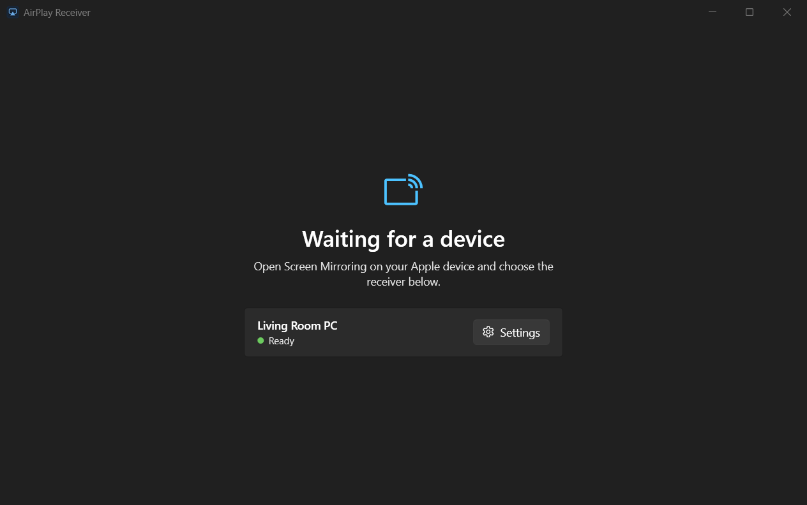
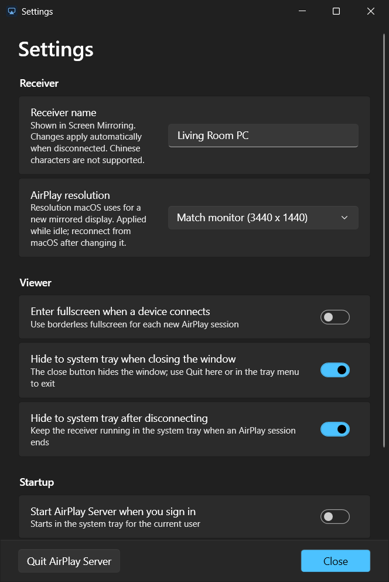

# AirPlayServer for Windows

AirPlayServer receives AirPlay video, audio, and screen mirroring on Windows.

This project is an updated fork of [fingergit/airplay2-win](https://github.com/fingergit/airplay2-win).

## Main Screen
<div align="center">
    
</div>

## Settings
<div align="center">
    
</div>

## Install

1. Install [Bonjour for Windows](https://support.apple.com/kb/DL999) if it is not already installed. iTunes also includes Bonjour.
2. From the [latest release](https://github.com/xenos1337/AirPlayServer/releases/latest), download one of:
   - `AirPlayServer-Setup-x64.exe`: the installer. It also installs the .NET 10 Desktop Runtime if needed and allows the app through Windows Firewall.
   - `AirPlayServer-Portable-x64.zip`: extract it anywhere and run `AirPlayServer.exe`. Needs the [.NET 10 Desktop Runtime](https://dotnet.microsoft.com/download/dotnet/10.0) (x64).

AirPlay Server checks GitHub for a newer release once a day and offers to open its download page; turn this off in `Settings`.

The app warns you at startup if Bonjour is missing. If its service is not running, the app offers to start it; Windows asks for administrator permission. If the receiver becomes unavailable later, the home screen shows a `Restart Bonjour service` button.

Only one AirPlayServer runs at a time. Starting it again brings the running window to the front.

### Requirements

- Windows 10 or later, x64
- [.NET 10 Desktop Runtime](https://dotnet.microsoft.com/download/dotnet/10.0) (x64)
- Apple Bonjour for Windows, used for device discovery over mDNS

## Features

- Screen mirroring and audio from iOS and macOS; unsupported standalone URL/HLS playback is not advertised
- 30 and 60 FPS quality presets
- GPU texture upload and YUV to RGB conversion
- Frame pacing for smoother playback
- Live window resizing
- Receiver resolution matched to a monitor or set manually
- Automatic Bonjour service advertisement

## Use AirPlayServer

1. Start AirPlayServer.
2. Open Control Center on an iPhone or iPad, or open the AirPlay menu on a Mac.
3. Select the Windows PC from the list.
4. Start mirroring or playback.

### Receiver resolution

Open `Settings` and use `AirPlay resolution` to control the display size advertised to macOS. `Match monitor` is the default: while the receiver is idle, move its window to the Windows monitor you want to match. The advertised size follows that monitor's current mode.

Select `Custom` to enter an exact width and height, such as `1920 x 1080` or `2560 x 1440`. Resolution changes are applied when the receiver is idle. Stop and reconnect Screen Mirroring on the Mac to negotiate the new size; an active stream is never interrupted.

### Debug logging

To collect diagnostics for playback or audio-output switching issues, start the
server with `AirPlayServer.exe --debug`. A new timestamped log is written for
each run under `%LOCALAPPDATA%\AirPlayServer\logs` (or the system temporary
directory if `LOCALAPPDATA` is unavailable). The log includes startup and
shutdown, connection/device identifiers, AirPlay protocol messages, playback
and volume callbacks, thread IDs, and unhandled exception details. Each session
also writes a per-frame timing CSV (`*-perf.csv`) next to the log. Debug mode
is opt-in and does not create log files during normal launches. Press `F1`
while connected for live diagnostics without logging.

### Settings and firewall

Settings are stored in `%APPDATA%\AirPlayServer\airplay_settings.ini`. A
settings file next to `AirPlayServer.exe` from an earlier version is copied
there on first start.

If Windows Firewall blocks the receiver, the home screen says so and offers to
allow it on private networks (administrator permission required). On a network
set to Public it links to the network settings instead.

### Optional AirPlay PIN

Enable `Require PIN` in `Settings` to approve new connections with a temporary four-digit code. The PIN exists only in memory for the current server session and is never written to disk.

`Hide PIN from screen capture` protects the code from supported Windows recording APIs. After you accept a connection, AirPlayServer excludes the PIN window from capture and waits one second before displaying the PIN. If Windows cannot enable capture exclusion, the app does not display the PIN.

### Controls

| Key | Action |
|-----|--------|
| `H` | Toggle session controls |
| `Ctrl+Shift+H` | Toggle capture privacy |
| `P` | Toggle picture-in-picture mode |
| `F` or double-click | Toggle fullscreen |
| `F1` | Toggle diagnostics while connected |
| `R` | Rotate video 90 degrees clockwise |
| Mouse wheel | Zoom from fit to 5x |
| Left-drag while zoomed | Pan the video |
| Mouse movement | Show the cursor; it hides after five seconds |

While a device is connected, the session controls are shown in a panel beside the video. Hide it with the arrow button at its top or `H`; the arrow on the right edge brings it back. Closing the window during a session ends the session and returns to the home screen. They include `Hide from captures`, which keeps the receiver visible on the local monitor, excludes its window from supported Windows capture APIs, and sends a black frame to the clean feed. Turn the switch off or press `Ctrl+Shift+H` to end it.

Select `Picture in picture` or press `P` to open a small, borderless window that stays above other apps. PiP keeps the current device's aspect ratio when resized. Drag the strip along the top to move it, and use its close button or press `P` again to restore the previous window size, position, and maximized state. PiP also closes when the device disconnects.

### Screen Cast and the OBS clean feed

Enable `Screen Cast mode` from the session controls to create a separate video-only window named `AirPlay Receiver - Clean Feed`. The normal receiver window remains available on the local display.

To use it in OBS:

1. Add a Window Capture source and choose the Windows 10/11 capture method.
2. Select `AirPlay Receiver - Clean Feed`.
3. Turn off `Capture Cursor` in OBS.

In Discord, open `Share Your Screen`, choose `Applications`, and select `AirPlay Receiver - Clean Feed`. The window exists only while a device is connected and AirPlayServer is rendering video.

The clean feed follows rotation, zoom, pan, and receiver window resizing. `Crop clean feed to video` removes letterboxing and pillarboxing. AirPlayServer hides the clean feed between sessions and restores it after a device reconnects.

`Hide interface from captures` excludes the local receiver from supported Display Capture paths on Windows 10 version 2004 and later. It is meant to keep controls out of a presentation. It is not DRM. Use Window Capture in OBS for the clean feed.

`Output volume` is the receiver's own volume on top of the sender's. Each new connection starts it at 30% or lower so a sender at full volume does not start loud; turn it up from the session controls.

### Quality presets

You can change the preset from the session controls while video is playing.

| Preset | FPS | Scaling | Intended use |
|--------|-----|---------|--------------|
| Best | 30 | Best available | Sharpest image |
| Balanced | 60 | Best available | Default setting |
| Low latency | 60 | Linear | Fastest response |

## Troubleshooting

### The device does not appear

- Check that Bonjour is installed and that `Bonjour Service` is running in `services.msc`.
- Put both devices on the same Wi-Fi network and subnet.
- Allow AirPlayServer through Windows Firewall on private networks.

### The device connects but video or audio does not play

- If Windows is running in a virtual machine, use bridged networking instead of NAT.
- Disconnect any VPN or proxy that may be intercepting the local connection.

## Headless adapter

The `MirrorSimAdapter` sidecar exposes protocol `0.8.0`, including bounded H.264 access-unit and interleaved signed 16-bit PCM audio events, sender-volume changes, receiver-reported source/video geometry, and explicit mirror sender pause/resume events over JSONL. The source-screen shape provides orientation without mistaking a separate landscape media surface for a rotated phone. Video and audio serialization run on bounded worker queues so a busy desktop client cannot block the AirPlay network callback; overloaded video output drops forward to the next decoder keyframe instead of building an unbounded backlog, and repeated codec-only packets are deduplicated.

When a host sets `MIRRORSIM_EXTERNAL_DNSSD=1`, the headless adapter skips its Bonjour client registration and lets the host advertise `_airplay._tcp` and `_raop._tcp` itself. `MIRRORSIM_HARDWARE_ADDRESS` accepts the shared 12-digit hexadecimal discovery identity, keeping AirPlay identity stable between the native protocol server and the external advertiser.

The headless adapter advertises mirroring and audio capabilities only. Media apps therefore remain inside the mirrored screen instead of handing standalone playback to the receiver's intentionally unsupported URL/HLS path.

Mirror timing requests use a 300 ms response window and a three-second cadence. Timing failures and AirPlay control lifecycle transitions are summarized on stderr for MirrorSim diagnostics without flooding the sender or the support log.

## Build from source

The native projects target Visual Studio 2026 with the v145 toolset and a Windows 10 SDK.
The user interface is a WPF app and needs the .NET 10 SDK.
With Visual Studio 2022, build from a Developer Command Prompt using
`msbuild AirPlay.sln /restore /p:Configuration=Release /p:Platform=x64 /p:PlatformToolset=v143 /m`.

1. Clone the repository
   ```bash
   git clone https://github.com/xenos1337/AirPlayServer.git
   ```

2. Open `AirPlay.sln` in Visual Studio.
3. In Solution Explorer, right-click `AirPlayServer` and select `Set as Startup Project`.
4. Build with `Ctrl+B` or run with `F5`.

The Debug executable is written to `x64\Debug\AirPlayServer.exe`.

## Project layout

```text
AirPlayServer/
|-- AirPlayServer/           # WPF app (.NET 10): windows, settings, tray
|   |-- MainWindow.xaml      # Home screen, video host, and session controls
|   |-- SettingsWindow.xaml  # Receiver and security settings
|   `-- Native.cs            # Interop with AirPlayCore.dll
|-- AirPlayCore/             # Native DLL: receiver, SDL2 video, and audio
|   |-- AirPlayCore.h        # C API used by the WPF app
|   |-- CSDLPlayer.cpp       # Video and audio playback on a render thread
|   |-- CAirServer.cpp       # AirPlay server wrapper
|   `-- CAirServerCallback.cpp
|-- AirPlayServerLib/        # AirPlay 2 protocol library
|   `-- lib/                 # RAOP, pairing, crypto, and codecs
|-- airplay2dll/             # DLL wrapper and FFmpeg H.264 decoder
|-- MirrorSimAdapter/        # Headless JSONL adapter
|-- tests/                   # Codec and protocol smoke tests
|-- dnssd/                   # Bonjour discovery DLL
|-- external/                # SDL2, FFmpeg, and other dependencies
`-- AirPlay.sln
```

## Contributing

Bug reports, feature requests, and pull requests are welcome. Follow the existing C++ and Windows API style, test on Windows 10 or 11, and update the documentation when behavior changes.

## License

Repository-authored code is provided under the MIT license. The receiver also
uses OSI-approved third-party components, including dynamically linked FFmpeg
under LGPL-2.1-or-later, libplist under LGPL-2.1-or-later, and PlayFair
interoperability code under GPL-3.0. See [THIRD_PARTY_NOTICES.md](THIRD_PARTY_NOTICES.md)
for component scope, exact FFmpeg build provenance, source availability, and
license locations.

## Credits

Thanks to [fingergit](https://github.com/fingergit/airplay2-win) and the AirPlay reverse engineering community.

This is an unofficial implementation. Apple, AirPlay, and related trademarks belong to Apple Inc.
